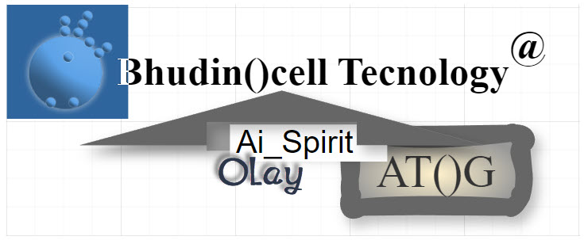
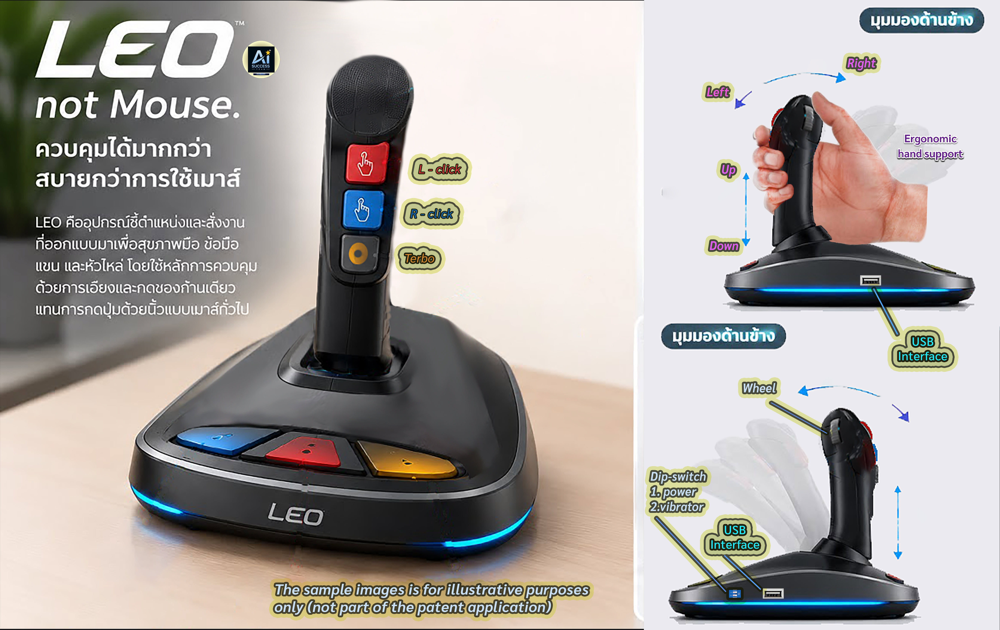
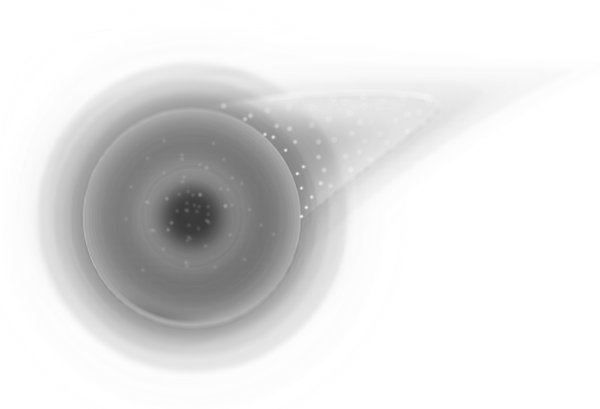

# AI-SUCCESS TEAM FOUNDATION — Ob()π System Interface | Temporary Domain

> ### ⚠️ LEGAL BANNER
> **Temporary Presentation Domain — Educational Portfolio — Not Investment Solicitation — EOI Only**
>
> This repository is a **temporary presentation domain** for educational and portfolio purposes. No offer to sell, no solicitation of investment, no financial advice. All interactions are **Expression of Interest (EOI) Only**.

---

> *All images above are local portfolio assets for educational demonstration. No commercial use.*

---

👉 Register: [Leo3c-V2-Countries-Locked.html](./Leo3c-V2-Countries-Locked.html)

📚 Policy TH: [Leo3c-Official-Policy-Complete.html](./Leo3c-Official-Policy-Complete.html)
📚 Policy EN: [Leo3c-Policy-International-English.html](./Leo3c-Policy-International-English.html)
📄 Bangkok Blueprint IMF 2026: [Bangkok-Blueprint-One-Pager.html](./Bangkok-Blueprint-One-Pager.html)
📢 Official Announcement: [Launch-Announcement-Dual.html](./Launch-Announcement-Dual.html)

## 🦠 Why Plastic-Eating Bacteria?
True implementation accounts for end-of-life. We integrate circular economy research: 
*Ideonella sakaiensis*, *FAST-PETase* (UT Austin 2022)

📚 Study Module: [Will be added - LEO3C-Sustainability-Plastic-Bacteria.html]

---

## 📛 Nomenclature Disclaimer — AI-SUCCESS Naming

> **Disclaimer:** Names like "AI-SUCCESS TEAM", "Ob()π", "LEO-3C", "Bangkok Blueprint" are **temporary working titles** for this educational portfolio / self-generated work experiment. They do not represent a registered corporation, licensed entity, or formal affiliation with any institution unless explicitly stated in a final incorporation document. Any resemblance to existing trademarks is coincidental and for conceptual illustration only. This repo will be renamed upon formal funding / incorporation.

---

## 🧭 Navigation — REAL Links to Existing Files in Root

> All links below point to **actual files currently in repo root**. If a file 404s, it has not been pushed yet.

| # | Document | Real Relative Link | Purpose |
|---|----------|-------------------|---------|
| 1 | **Policy Thai (Official Complete)** | [Leo3c-Official-Policy-Complete.html](./Leo3c-Official-Policy-Complete.html) | ฉบับสมบูรณ์ ภาษาไทย — นโยบายหลัก LEO-3C V2.4 |
| 2 | **Policy English (International)** | [Leo3c-Policy-International-English.html](./Leo3c-Policy-International-English.html) | International policy version for global review |
| 3 | **Portal V2.4 — Countries Locked (7 Nations)** | [Leo3c-V2-Countries-Locked.html](./Leo3c-V2-Countries-Locked.html) | **This IS the V2.4 quota-locked portal** — see Two-Track below |
| 4 | **Bangkok Blueprint — IMF One-Pager** | [Bangkok-Blueprint-One-Pager.html](./Bangkok-Blueprint-One-Pager.html) | IMF-aligned macro concept: Ob()π Interface |
| 5 | **Launch Announcement — Dual Language** | [Launch-Announcement-Dual.html](./Launch-Announcement-Dual.html) | Official launch announcement TH/EN |
| 6 | **1-Minute Pitch** | [leo_x5f_3c_x5f_minute_x5f_pitch.html](./leo_x5f_3c_x5f_minute_x5f_pitch.html) | 60-second investor/educational pitch |
| 7 | **PCT Claims Summary** | [leo_x5f_3c_x5f_pct_x5f_claims.html](./leo_x5f_3c_x5f_pct_x5f_claims.html) | Patent Cooperation Treaty claims excerpt — educational |
| 8 | **Public Education Module** | [leo_x5f_3c_x5f_public_x5f_education.html](./leo_x5f_3c_x5f_public_x5f_education.html) | Public understanding of LEO-3C system |
| 9 | **Temporary Letterhead** | [Ai-Success-Letterhead-Temporary.html](./Ai-Success-Letterhead-Temporary.html) | Temporary letterhead — not official stationery |
| 10 | **Home / Index** | [index.html](./index.html) | Root index redirect / landing |

---

## 🚀 Two-Track Execution — V2.4 Quota Locked

**Portal File:** [Leo3c-V2-Countries-Locked.html](./Leo3c-V2-Countries-Locked.html) — **This IS the portal.**

### Locked 7 Countries — RESERVED (No New EOI for these geos)

| Code | Country | Status | Note |
|------|---------|--------|------|
| TH | Thailand | 🔒 RESERVED | Blueprint Origin |
| US | United States | 🔒 RESERVED | Track A — PCT |
| JP | Japan | 🔒 RESERVED | Track A — Tech |
| CN | China | 🔒 RESERVED | Track B — Mfg |
| EU | European Union | 🔒 RESERVED | Track A — Regulatory |
| KR | South Korea | 🔒 RESERVED | Track B — Battery |
| UK | United Kingdom | 🔒 RESERVED | Track A — Finance |

> **All 7 are currently locked for initial quota allocation.** This is intentional to prevent over-subscription during the temporary domain phase.

**If you are from a locked country and want to discuss:**

📧 Contact: **bhudrose@gmail.com** — Subject: `[EOI-LOCKED-COUNTRY] Your Country Code + Background`

**Open for EOI:** All other countries (Track C) — EOI Only, no commitment.

**Execution Model:**
- **Track 1 — Educational Portfolio:** This repo, public docs, Ob()π teaching interface
- **Track 2 — Formal Entity:** To be incorporated after self-generated work funding improvement — separate legal entity, separate cap table

No funds are accepted via this repository.

---

## 🌱 Sustainability Module — Plastic Biodegradation (Ideonella + PETase)

LEO-3C circular system includes a **Sustainability Research Track** inspired by peer-reviewed breakthroughs:

### Core Organisms & Enzymes
- **Ideonella sakaiensis 201-F6** — Discovered in 2016, PET bottle recycling plant in Sakai, Japan. Capable of degrading PET film via two enzymes.
- **FAST-PETase** — Engineered variant from UT Austin (2022), functional at 30-50°C, significantly faster depolymerization.

### Reference Literature (External)
- Yoshida et al., *Science* 2016: "A bacterium that degrades and assimilates poly(ethylene terephthalate)" — [DOI: 10.1126/science.aad6359](https://www.science.org/doi/10.1126/science.aad6359)
- Lu et al., *Nature* 2022 (UT Austin): "Machine learning-aided engineering of hydrolases for PET depolymerization" — [UT Austin News](https://news.utexas.edu/2022/04/27/plastic-eating-enzyme-could-eliminate-billions-of-tons-of-landfill-waste/) / [Nature 2022](https://www.nature.com/articles/s41586-022-04599-z)

> This module is **educational**. We do not claim ownership of these discoveries. All credit to original researchers.

### Next File To Create (Suggested)

`leo3c_sustainability_plastic_bacteria.html`

This future file should contain:
- PET lifecycle diagram (Ob()π loop)
- Comparison table: Natural PETase vs FAST-PETase vs Chemical recycling
- Educational disclaimer: Lab-contained research only
- Link back to this README and to [Public Education](./leo_x5f_3c_x5f_public_x5f_education.html)

**Status:** Planned — not yet in root. Create as separate HTML to keep this README lightweight.

---

## 🏗️ Temporary Domain Explanation

**Why is this a "Temporary Presentation Domain"?**

This GitHub repository (`Rose-007/ai-success-team.com`) is intentionally a **temporary domain** until funding improves **from self-generated work** (not from solicitation).

- **Current Phase:** Educational portfolio — demonstrate ability to organize complex policy, PCT claims, and IMF-adjacent concepts into readable HTML.
- **All images** (`Logo03.jpg`, `BhudinCell.jpg`, `Leo3c-hand.jpg`, `JITTA'st&Others.png`) are for **portfolio demonstration only**.
- **All docs** are static HTML in root for transparency — no hidden backend.
- **No investment portal** — the V2.4 locked file is a quota visualization, not a checkout.
- When self-generated work funding improves, this will migrate to a proper domain with formal incorporation and audited docs.

**Inspiration:** `uhuboy/MiniPen` — minimal pen, maximal clarity philosophy.

---

## 📫 Contact & Philosophy

**Contact:** bhudrose@gmail.com

**Philosophy:**

> *Everyone starts counting from one equally...*
> *Ob()π — Observation begins at one, loop returns to purpose.*
> *We count the same starting line, we differ in how we persist through the loop.*

This project believes in **equal start, accountable loop**. No insider quotas beyond the 7 locked for operational focus. All new EOI evaluated on contribution, not pedigree.

**EOI Only:** Send background, not funds. No DMs asking for investment links — they do not exist in this phase.

---

## ⚖️ Full Legal Disclaimer

**Last Updated:** 2026-05-13 — Temporary Domain Version

1.  **Not Investment Solicitation:** Nothing in this repository constitutes an offer to sell, solicitation of an offer to buy, or recommendation of any security, token, or investment product.
2.  **Educational Portfolio Only:** All HTML files, images, and markdown are for educational and portfolio demonstration of document organization and concept communication.
3.  **No Legal Entity (Yet):** "AI-SUCCESS TEAM FOUNDATION" is a working title. No foundation is registered under this exact name as of this commit. Formal entity will be disclosed upon incorporation.
4.  **EOI Only:** Expression of Interest is non-binding. No reservation of rights, no guarantee of future allocation.
5.  **Temporary Presentation Domain:** This GitHub Pages / repo is temporary. Content may move or be deleted without notice.
6.  **Third-Party Research:** Sustainability references (Ideonella, PETase) belong to original authors. Links to *Science* and *Nature* are for citation.
7.  **No Warranty:** Content provided "AS IS" without warranty. Author not liable for reliance.
8.  **Contact:** For corrections, email bhudrose@gmail.com with subject `[CORRECTION-REQUEST]`.

---

### LICENSE

See [LICENSE](./LICENSE) — MIT (for code structure, not for concepts). Concepts retain educational copyright by author.

**Ready to paste:** Replace current `README.md` in root with this content.

> Generated by final_readme_real_links.html builder — v1.0 — No external image hotlinking for GitHub rendering except shields.
